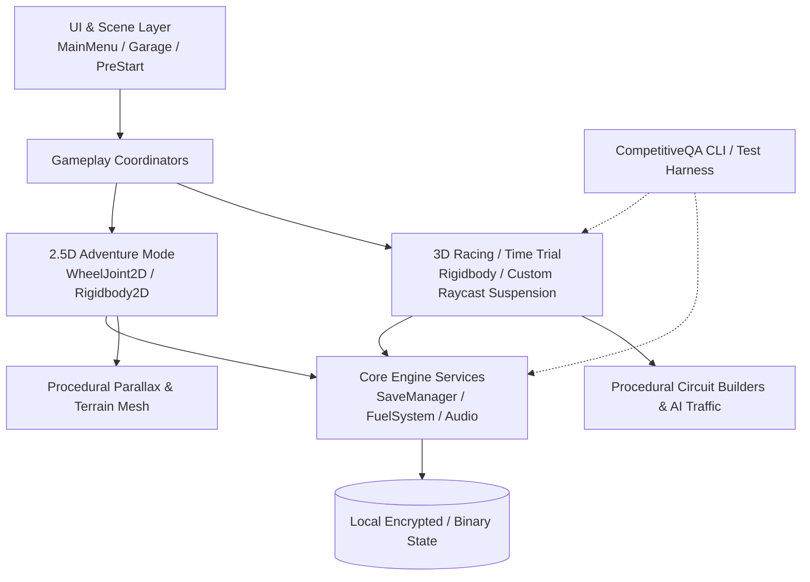

# Hill Adventurer — Technical Architecture

This document outlines the internal architecture, design principles, scene lifecycle, and physics separation of **Hill Adventurer**.

---

## 1. System Overview

Hill Adventurer is developed in **Unity 6 (6000.3.13f1)** using the **Universal Render Pipeline (URP)**, targeting mobile (Android) and desktop platforms.

The codebase is organized into four main layers:
1. **Presentation & UI**: Scene flow, menu management, Garage live compositor.
2. **Simulation & Gameplay**: Dual physics engines (2.5D suspension and 3D circuit dynamics).
3. **Core Systems**: State persistence (`SaveManager`), upgrade progression, monetization/ad abstractions.
4. **Validation & Tooling**: Headless .NET CLI lab (`CompetitiveQA`) and in-editor foundation auditors.



---

## 2. Scene Graph & Navigation

The production game operates across six dedicated scenes:

```
           ┌──────────────┐
           │   MainMenu   │
           └──────┬───────┘
                  │
        ┌─────────┴─────────┐
        ▼                   ▼
  ┌───────────┐       ┌───────────┐
  │  Garage   │       │ PreStart  │
  └─────┬─────┘       └─────┬─────┘
        └─────────┬─────────┘
                  │
  ┌───────────────┼───────────────┐
  ▼               ▼               ▼
┌──────────────┐ ┌──────────────┐ ┌──────────────┐
│ Adventure2_5D│ │ Adventure3D  │ │ TimeTrial3D  │
└──────────────┘ └──────────────┘ └──────────────┘
```

1. **`MainMenu`**: Entry point, audio initialization, high-level mode selection.
2. **`Garage`**: Vehicle selection, 3-layer live preview compositor (Skins, Wheels, Driver Stickman pose), upgrade purchase interface.
3. **`PreStart`**: Track selection, environment profile loading, launch preparation.
4. **`Adventure2_5D`**: Procedural hill-climb terrain, physics-based 2D suspension, stunt detection, coin/gem collection.
5. **`Adventure3D`**: Full 3D environment exploration, hill navigation with 3D camera damping.
6. **`TimeTrial3D`**: Structured competitive racing circuit with checkpoints, lap timing, and ghost telemetry.

---

## 3. Vehicle Physics: Dual Pipeline Architecture

To achieve both arcade responsive 2D hill climbing and competitive 3D racing, the project intentionally decouples 2D and 3D physics pipelines:

### A. 2.5D Adventure Physics (`VehicleController.cs`)
- **Physics Core**: Unity `Rigidbody2D` with two `WheelJoint2D` suspension links.
- **Drive Train**:
  - `EngineController`: Computes engine RPM, torque curve, and gear ratios.
  - `TransmissionController`: Automatic shift timing with power-band retention.
  - `FuelSystem`: Progressive depletion based on engine load and distance; pickups replenish tank.
- **Air Control**: Dynamic in-air torque simulation (Gas = nose-up pitch, Brake = nose-down pitch) and aerodynamic downforce without artificial horizontal velocity.

### B. 3D Circuit Physics (`RoadVehicleController.cs`)
- **Physics Core**: Unity 3D `Rigidbody` with center-of-mass balancing.
- **Suspension Model**: Raycast spring-damper math per wheel calculated in `FixedUpdate` to eliminate physics jitters at high speeds.
- **Aerodynamics & Slip**: Longitudinal tire grip and lateral slip curves derived from vehicle setup ScriptableObjects (`VehicleDefinition.asset`).

---

## 4. Customization Compositor

The garage customization system (`GarageUI.cs`, `GaragePreviewRenderer.cs`) avoids monolithic prefab variants by composing vehicles dynamically at runtime across 3 independent channels:

1. **Vehicle Skin**: Texture / material variants applied to the vehicle body mesh or sprite renderer.
2. **Wheel Variants**: Paired front and rear wheel meshes/sprites with dedicated tire friction definitions.
3. **Driver System**: Modular humanoid stickman (`Stickman_Black`) with per-vehicle authored seat/compact poses, head collision triggers, and damped angular neck reaction.

State is serialized under `AHR.Customize.*` keys, decoupled from economy and track records.

---

## 5. Offline QA & Simulation Laboratory

Hill Adventurer contains an out-of-engine headless testing lab located in `Tools/CompetitiveQA/`:

- Built on modern .NET CLI (`net10.0`).
- Simulates thousands of race outcomes, MMR distribution changes (`MmrEconomyLab.cs`), and season expansion economics without needing Unity Editor frames.
- Enables continuous integration and regression testing for competitive fairness before publishing game updates.
